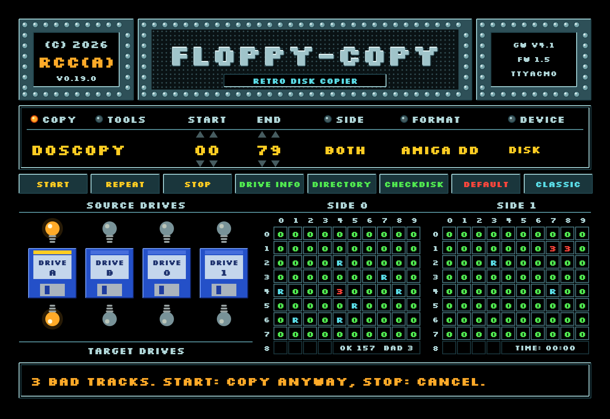
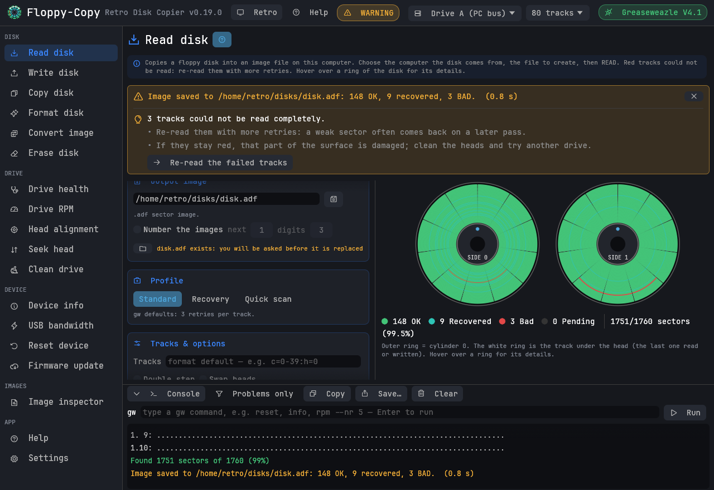
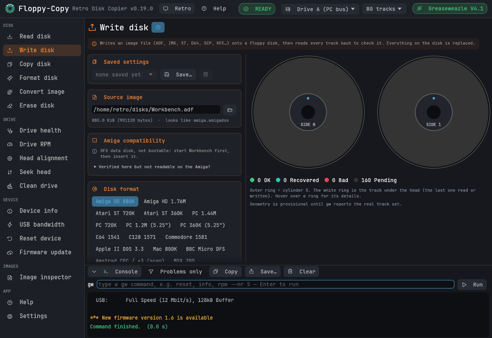
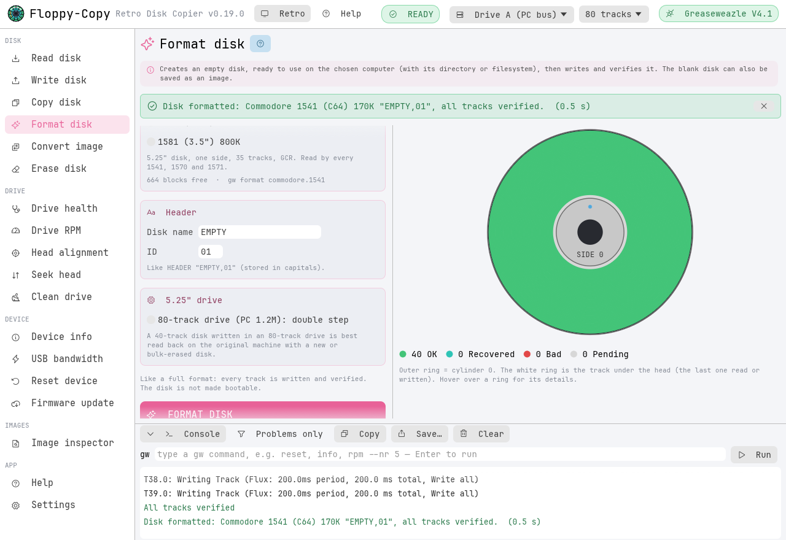
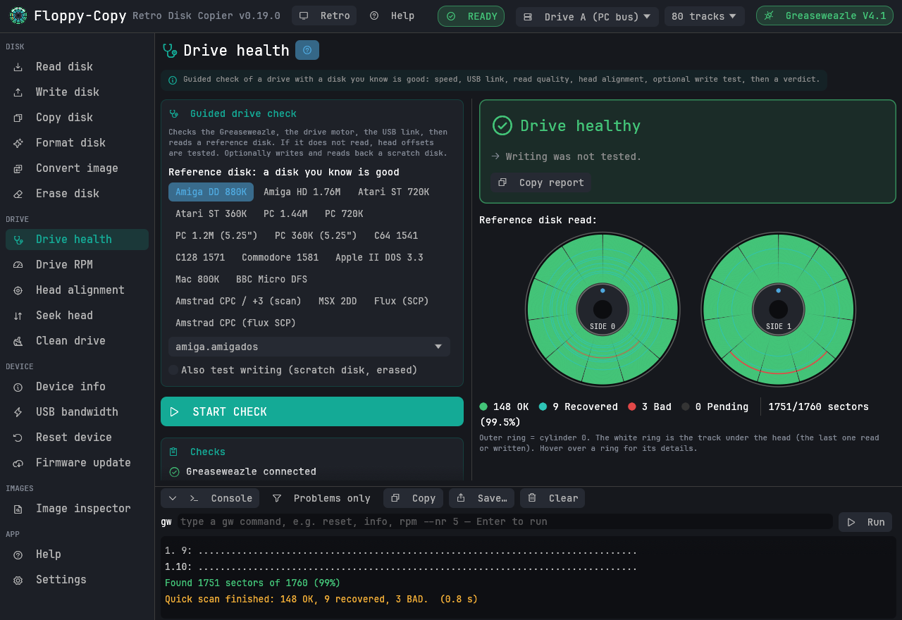
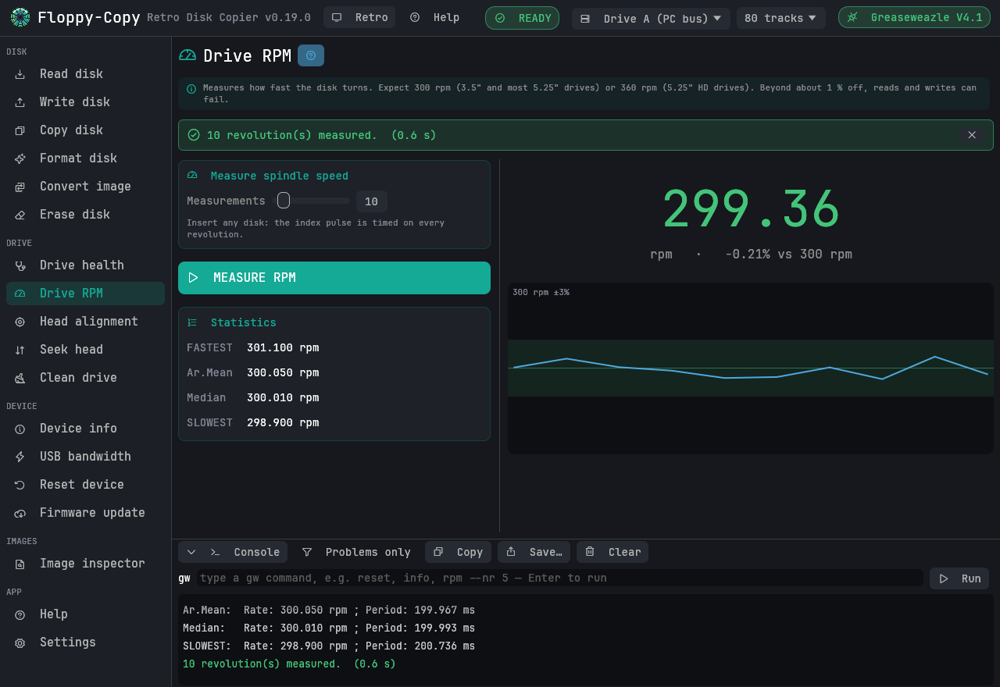
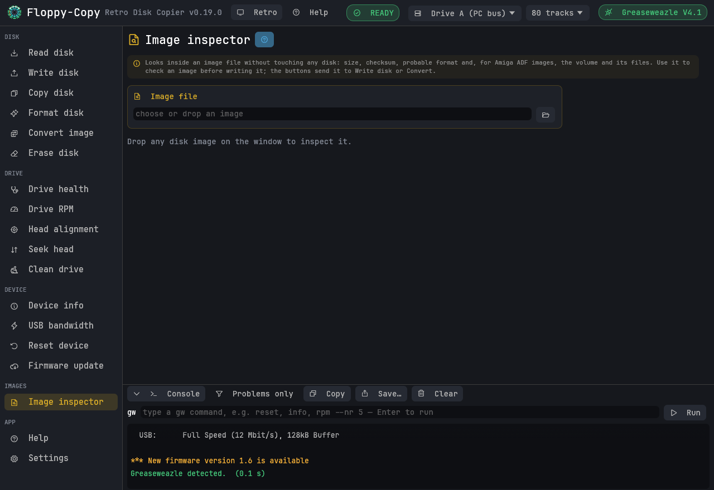
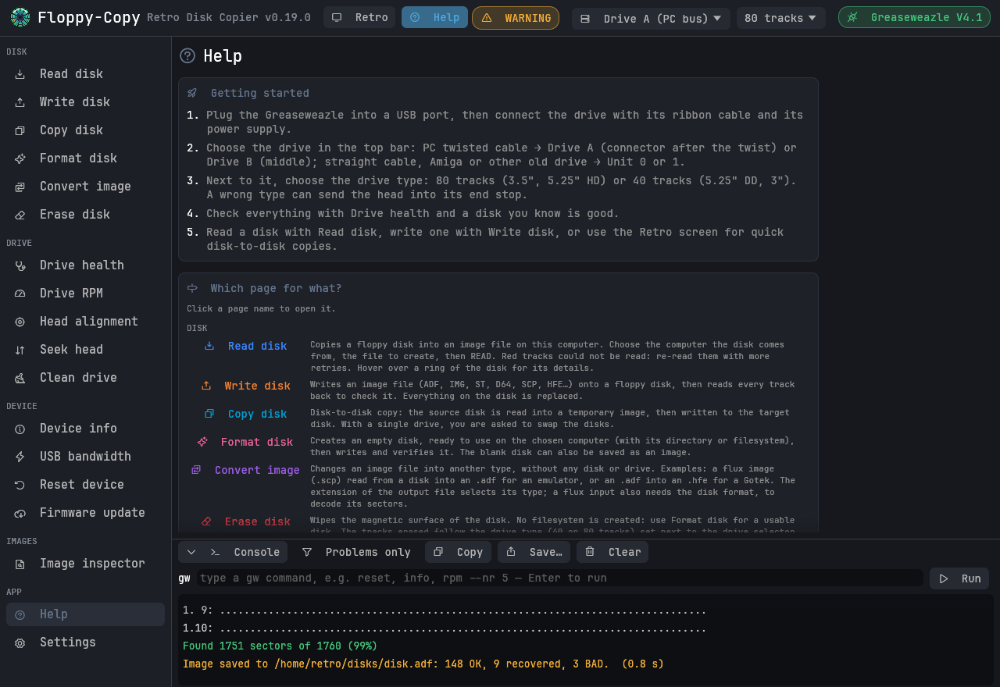

<p align="center">
  
</p>

<h1 align="center">Floppy-Copy</h1>

<p align="center"><b>Retro Disk Copier</b></p>

<p align="center">
  <a href="README.md">English</a> · <b>Français</b>
</p>

<p align="center">
  Une interface graphique conviviale pour les outils <a href="https://github.com/keirf/greaseweazle">Greaseweazle</a> de lecture et d'écriture de disquettes.<br>
  Lire, écrire, copier, formater et diagnostiquer des disquettes — Amiga, PC, Atari ST, Commodore, Apple II, BBC Micro et bien d'autres.<br>
  Windows · macOS · Linux — <b>v0.19.0</b> — © 2026 RCC(A)
</p>

<p align="center">
  
</p>

Floppy-Copy pilote pour vous les outils Greaseweazle (`gw`). Il couvre toutes les commandes
`gw`, montre la disquette piste par piste et secteur par secteur pendant la lecture ou l'écriture,
explique les erreurs en langage clair, et ne lance jamais une opération destructrice sans
demander confirmation.

*Anciennement HappyGreaseFloppy, et FluxMyFluffyFloppy avant cela.* En plus de l'écran rétro
ci-dessus, une interface classique donne accès à toutes les options. L'interface de l'application est en anglais ; les noms de
pages et de boutons sont donnés ici tels qu'ils apparaissent à l'écran.

## Points forts

* **Voir la disquette** : les deux faces dessinées en anneaux de pistes, chaque piste colorée au
  fil de la lecture ou de l'écriture (bonne, récupérée après plusieurs essais, illisible), le
  détail des secteurs au survol, la progression avec le temps restant.
* **Comprendre les échecs** : « No Index », « Track 0 not found », « Failed to verify », disquette
  protégée, débordement USB… chacun est accompagné de ce qu'il faut vérifier et, quand c'est
  utile, d'un bouton vers le bon outil.
* **Récupérer les disquettes usées** : profil *Recovery*, puis *Re-read the failed tracks*, qui
  ne relit que les pistes en échec.
* **Copier des disquettes** avec un seul lecteur (on vous demande d'échanger les disquettes) ou
  deux, en secteurs ou en flux brut (conserve les protections anticopie).
* **Formater** des disquettes vierges pour Amiga, PC, Atari ST, MSX, Commodore 1541/1571/1581,
  BBC Micro et Apple II.
* **Contrôler un lecteur** en une fois : vitesse du moteur, liaison USB, lecture d'une disquette
  de référence (avec un test de décalage des têtes si elle échoue), test d'écriture facultatif,
  et un verdict.
* **Archiver une boîte de disquettes** : numérotation automatique (`disk_001.adf`,
  `disk_002.adf`…), réglages enregistrés par machine, journal de toutes les commandes.
* **Écran rétro de copieur** : un clic sur *Retro* transforme la fenêtre en copieur plein écran
  dans l'esprit des copieurs de disquettes classiques de l'Amiga — plaques métalliques, police
  pixel, voyants des lecteurs, une grille de pistes 0-79 par face, une ligne d'état.
* **Protège les lecteurs 40 pistes** : indiquez qu'un lecteur est un 5,25" 40 pistes (360K) ou
  un 3", et Floppy-Copy refuse ce qui enverrait la tête en butée (un format Amiga ou 720K, un
  double pas, un déplacement au cylindre 79) et limite les lectures en flux et les effacements
  aux cylindres 0-39.
* **Aide intégrée** : une page *Help* (premiers pas, rôle de chaque page, glossaire, limites
  connues des outils gw) et une courte explication en haut de chaque page.
* **Taper n'importe quelle commande `gw`** dans la console (`reset`, `info`, `rpm --nr 5`…) ; le
  lecteur choisi est ajouté automatiquement.
* Thème sombre, clair ou celui du système ; taille du texte réglable ; la commande `gw` exacte
  affichée avant d'être lancée.

## Captures d'écran

| | |
|---|---|
|  |  |
| **Read disk** (interface classique) — une disquette Amiga usée, avec un conseil et *Re-read the failed tracks* | **Write disk** — avec la vérification de compatibilité Amiga |
|  |  |
| **Format disk** — une disquette Commodore 1541 vierge, écrite et vérifiée (thème clair) | **Drive health** — contrôle guidé avec un verdict |
|  |  |
| **Drive RPM** — vitesse, écart et historique | **Image inspector** — taille, SHA-256, explorateur AmigaDOS |
|  | |
| **Help** — premiers pas, pages, glossaire, limites connues | |

### Écran rétro de copieur

L'écran rétro est montré en haut de cette page. *Retro* dans la barre du haut l'affiche, *CLASSIC* revient à l'interface normale. Cliquez sur une
valeur pour la changer (clic droit : valeur précédente) :

* Modes **COPY** : *DOSCOPY* (secteurs décodés) et *NIBBLE* (flux brut, conserve les protections
  anticopie), du lecteur source vers le lecteur cible — le même lecteur convient aussi, on vous
  demande alors d'échanger les disquettes. Modes **TOOLS** : *DISK>IMAGE*, *IMAGE>DISK*,
  *FORMAT*, *ERASE*, *CHECK* (lecture rapide) et *SPEED* (vitesse de rotation).
* *START* / *END* (cylindres, avec les flèches), *SIDE* (les deux faces, 0 ou 1), *FORMAT* (les
  préréglages de machines) et *DEVICE* (le fichier image pour DISK>IMAGE et IMAGE>DISK).
* Lecteur source : les voyants au-dessus des lecteurs ; lecteur cible : ceux du dessous (ou clic /
  clic droit sur un lecteur).
* Dans les grilles, `0` est une piste bonne, un chiffre le nombre de secteurs illisibles, `R` une
  piste lue après plusieurs essais, `-` une piste vide ; survolez une case pour le détail.
  *DIRECTORY* liste le contenu d'une image AmigaDOS, *REPEAT* relance la dernière opération,
  *STOP* (ou `Échap`) l'interrompt.

Un design original : aucun logo, graphisme ou texte d'un programme existant n'est repris.

## Disquettes prises en charge

**La lecture, l'écriture, la copie et la conversion** fonctionnent avec tous les formats et
types d'image gérés par votre `gw` (environ 150 formats : Amiga, PC, Atari, Commodore, Apple,
Acorn, Amstrad, MSX, Mac, PC-98, TRS-80… ; ADF, IMG, ST, D64, DSK, HFE, SCP, IPF, KryoFlux et
d'autres). Des préréglages en un clic couvrent les machines courantes.

**Le formatage** (Floppy-Copy construit la disquette vierge, puis l'écrit et la vérifie, ou
l'enregistre comme image) :

| Ordinateur | Disquettes | Vérifié avec |
|---|---|---|
| Amiga | DD 880K, HD 1.76M — OFS ou FFS, mode International, nom de volume | amitools `xdftool` |
| PC | 360K, 720K, 1.2M, 1.44M, 2.88M — FAT12, nom de volume | mtools, dosfstools, pyfatfs |
| Atari ST | 360K simple face, 720K double face (TOS) | mtools, dosfstools |
| MSX | 1DD, 2DD (MSX-DOS) | mtools, dosfstools |
| Commodore | 1541 (C64), 1571 (C128), 1581 — nom et ID du disque | VICE `c1541` (octet pour octet) |
| BBC Micro | DFS 40 ou 80 pistes, simple ou double face, titre | dfsimage |
| Apple II | DOS 3.3, ProDOS (disquettes de données) | AppleCommander |

## Installation

Aucune version n'est publiée : le programme s'obtient de l'une de ces deux façons.

* **Le compiler** sur votre ordinateur (quelques minutes, voir [Compilation](#compilation)).
* **Le faire compiler par GitHub** : dans ce dépôt, *Actions* → *Release* → **Run workflow**.
  Une fois l'exécution terminée (environ 15 minutes), sa page propose les trois archives
  ci-dessous dans *Artifacts* (il faut être connecté à GitHub pour les télécharger). Rien n'est
  publié.

Les archives contiennent :

| Système | Archive | Démarrage |
|---|---|---|
| Windows 10/11 | `…-windows-x86_64.zip` | Décompressez et lancez `Floppy-Copy.exe`. Décompressez la version officielle des outils Greaseweazle dans le même dossier : `gw` est alors trouvé automatiquement. |
| macOS 11+ (Apple Silicon et Intel) | `…-macos-universal.zip` | Décompressez et placez `Floppy-Copy.app` dans Applications. L'application n'est pas notariée : la première fois, clic droit → **Ouvrir**. Installez `gw` avec `pip3 install greaseweazle`. |
| Linux x86_64 | `…-linux-x86_64.tar.gz` | Extrayez et lancez `./install.sh` (pour l'utilisateur courant, ajoute une entrée de menu). Installez `gw` avec `pip install --user greaseweazle`, et ajoutez-vous au groupe `dialout` pour l'accès USB. |

**`gw` est trouvé automatiquement** : chemin configuré, `PATH`, dossier du programme (et ses
sous-dossiers `greaseweazle-*`), installations Python de l'utilisateur (`~/.local/bin`, pipx,
`~/Library/Python/*/bin`, Homebrew) et, sous Windows, les dossiers `Scripts` de Python et les
dossiers `greaseweazle-*` de Téléchargements, Bureau et Documents. *Settings → Auto-detect*
relance la recherche ; la variable d'environnement `FLOPPY_COPY_GW` impose un chemin.

## Premiers pas

1. **Branchez** le Greaseweazle en USB, et le lecteur avec sa nappe et son alimentation.
2. **Choisissez le lecteur** dans la barre du haut :
   * lecteur PC sur nappe croisée : **Drive A** sur le connecteur du bout (après le croisement),
     **Drive B** sur celui du milieu ;
   * lecteur PC sur nappe droite : **Drive B** ;
   * lecteur Amiga, Atari ou autre lecteur ancien (nappe droite) : **Unit 0** ou **Unit 1**.

   À côté, choisissez le **type de lecteur** : *80 tracks* (3,5", 5,25" HD 1,2 Mo) ou
   *40 tracks* (5,25" DD 360K, 3"). Un lecteur 40 pistes laissé sur 80 pistes peut aller en butée.
3. **Vérifiez l'installation** avec *Drive health* et une disquette que vous savez bonne.
4. **Lire une disquette** : choisissez le préréglage de la machine, le fichier de destination,
   puis *Read disk to image*. Les pistes rouges peuvent être relues avec *Re-read the failed
   tracks*.
5. **Écrire une disquette** : choisissez l'image, vérifiez le format (détecté d'après l'image),
   puis *Write image to disk*. Chaque piste est vérifiée.

Sans matériel, lancez-la avec `FLOPPY_COPY_GW=tools/fake-gw.py` (Linux, macOS ; Python 3 nécessaire)
pour l'essayer avec un simulateur.

## Les pages

| Page | Commande `gw` | Rôle |
|---|---|---|
| Read disk | `read` | préréglages, profils *Standard* / *Recovery* / *Quick scan*, toutes les options avancées (révolutions, essais, PLL, index simulé, disquette réversible, densité…), numérotation des disquettes, options de fichier image (HFE, SCP, KryoFlux) |
| Write disk | `write` | détection du format, contrôle de la taille, effacement préalable, essais de vérification, précompensation, vérification de compatibilité Amiga |
| Copy disk | `read` + `write` | un ou deux lecteurs, copie en secteurs ou en flux, pistes source illisibles signalées avant l'écriture |
| Format disk | `write` | disquettes vierges pour les ordinateurs ci-dessus ; double pas pour les disquettes 40 pistes dans un lecteur 80 pistes |
| Convert image | `convert` | entre types d'image, plages de pistes, PLL, ajustement de vitesse |
| Erase disk | `erase` | plage de pistes, révolutions, effacement haute fréquence |
| Drive health | `info` `rpm` `bandwidth` `read` `write` | contrôle guidé avec verdict et rapport copiable |
| Drive RPM · Head alignment | `rpm` · `align` | mesures et graphiques en direct |
| Seek head · Clean drive | `seek` · `clean` | confirmation pour les cylindres extrêmes, progression du nettoyage |
| Device info · USB bandwidth | `info` `bandwidth` | informations sur le Greaseweazle, test de la liaison USB |
| Drive delays · Interface pins (pages expert, affichées depuis *Settings → Drives*) | `delays` `pin` | délais du lecteur à côté des valeurs d'usine, lecture des signaux (index, piste 0, protection) |
| Reset device · Firmware update | `reset` `update` | fichier local, version GitHub, bootloader |
| Image inspector | — | taille, SHA-256, format deviné, explorateur AmigaDOS |
| Help | — | premiers pas, rôle de chaque page, glossaire, limites connues, liens vers le wiki |

Et aussi : réglages enregistrés (modèles) sur Read et Write, la ligne de commande `gw` avec un
bouton de copie sous les boutons d'action, un champ dans la console pour taper n'importe quelle
commande `gw`, un bouton *Stop* (ou `Échap`) pour toute opération en
cours, une console avec un filtre *problems only*, le glisser-déposer des fichiers image, un
journal facultatif, et une notification dans la barre des tâches ou le Dock quand une longue
opération se termine en arrière-plan.

## Dépannage

| Message | Cause habituelle |
|---|---|
| `No Index` | Pas de disquette, ou le lecteur ne tourne pas : disquette mal enfoncée, lecteur non alimenté, mauvais lecteur choisi (A/B ou 0/1), nappe à l'envers (voyant du lecteur toujours allumé). |
| `Track 0 not found` | Mauvais choix de lecteur ou nappe mal orientée (broche 1 aux deux bouts). |
| `Failed to verify Track …` | Disquette usée ou inadaptée (format DD sur disquette HD : masquez le trou de densité), têtes encrassées. Essayez une autre disquette, nettoyez les têtes, lancez *Drive health*. |
| Vérifiée, mais illisible sur l'Amiga | Voir la carte *Amiga compatibility* de la page Write : option restée active (inversion des têtes, double pas…), image FFS sur Kickstart 1.3, disquette déjà utilisée. |
| La tête cogne en bout de disque (lecteur 5,25" DD) | Le type de lecteur est *80 tracks* : choisissez *40 tracks* à côté du sélecteur de lecteur. |
| `requires optimised C extension` (Apple II, Commodore 1541/1571, Mac) | gw a été installé sans ses routines compilées : utilisez la version Windows officielle, ou réinstallez les outils avec un compilateur C (voir *Help → Known limits*). |
| *Head alignment* indisponible | `gw align` est arrivé avec les outils 1.21 : mettez-les à jour. |
| `Permission denied` (Linux) | Ajoutez-vous au groupe `dialout`, puis déconnectez-vous et reconnectez-vous. |
| macOS refuse d'ouvrir l'application | Clic droit → **Ouvrir** la première fois (l'application n'est pas notariée). |

Le [wiki Greaseweazle](https://github.com/keirf/greaseweazle/wiki) (en anglais) traite de la
partie matérielle :
[premiers pas](https://github.com/keirf/greaseweazle/wiki/Getting-Started),
[dépannage](https://github.com/keirf/greaseweazle/wiki/Troubleshooting-FAQ),
[sélection du lecteur](https://github.com/keirf/greaseweazle/wiki/Drive-Select).

## Compilation

Installez [Rust](https://rustup.rs) 1.95 ou plus récent et un compilateur C (macOS :
`xcode-select --install` ; Windows : *Build Tools for Visual Studio* avec « Développement
Desktop en C++ » ; Linux : `gcc`), puis :

```bash
cargo build --release -p hgf-gui
./target/release/floppy-copy                # target\release\floppy-copy.exe sous Windows
```

* Application macOS : `bash packaging/package.sh macos` → `dist/…-macos.zip` contenant
  `Floppy-Copy.app`.
* Entrée de menu et icônes sous Linux : `packaging/linux/install.sh`.

La création des paquets, les tests avec les outils de référence, l'icône et la publication sont
décrits dans [docs/DEVELOPMENT.md](docs/DEVELOPMENT.md) (en anglais). L'historique des versions
est dans [CHANGELOG.md](CHANGELOG.md).

## Remerciements et licences

* Matériel et outils [Greaseweazle](https://github.com/keirf/greaseweazle) de Keir Fraser —
  Floppy-Copy ne fait que lancer `gw`, il ne l'inclut pas.
* Inspiré de [FluxMyFluffyFloppy](https://github.com/FrankieTheFluff/FluxMyFluffyFloppy),
  l'interface Windows de FrankieTheFluff (code indépendant).
* Réalisé avec [egui/eframe](https://github.com/emilk/egui) et les
  [icônes Phosphor](https://phosphoricons.com) ; police
  [JetBrains Mono](https://www.jetbrains.com/lp/mono/) et, sur l'écran rétro,
  [Silkscreen](https://github.com/googlefonts/silkscreen) (toutes deux sous SIL Open Font
  License 1.1, voir `crates/hgf-gui/assets/fonts/`).
* Licences de toutes les bibliothèques utilisées :
  [THIRD-PARTY-LICENSES.txt](THIRD-PARTY-LICENSES.txt).

Floppy-Copy — Retro Disk Copier — © 2026 RCC(A). Aucune licence n'est accordée pour l'instant :
projet personnel, tous droits réservés.
